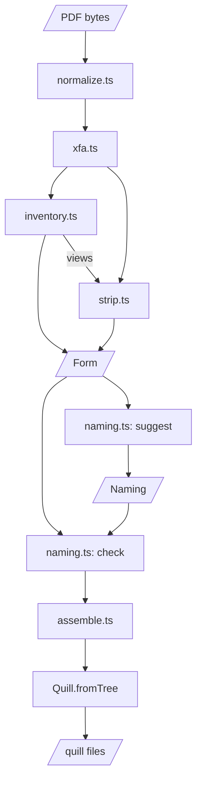

# Architecture

`sanitize` reads an untrusted PDF and returns plain data: a background PDF, the page sizes and the fields. `suggest` proposes a naming of the fields, `check` lists what is wrong with one, and `quillify` takes the form and a naming and writes a quill's files.

`sanitize.ts` runs the first four stages, and no stage imports another. A stage declines a file by throwing `Refused`. Any other error rejects the call. One `AbortSignal` fires at `MAX_SECONDS` (60): a stage waiting on a worker ends it, and work on the calling thread is not interrupted. `sanitize` needs `Worker` and `document`, so it does not run in Node (#34).

## Stages

### Normalize (`normalize.ts`)

- In: the caller's bytes, at most `MAX_BYTES`. Out: the file as qpdf rewrote it, at most `MAX_INFLATED_BYTES`.
- Later stages count on qpdf's output: empty-password encryption removed, page turns folded into content, no object stream, every stream recompressed.

### Convert a dynamic form (`xfa.ts`)

- In: what qpdf wrote. Out: the same bytes, or for a dynamic form a PDF redrawn from pdf.js's layout, with an AcroForm field for each control.
- Drop nothing quietly: a construct the redraw cannot draw refuses the file as `unpaintable`.
- pdf.js runs none of the form's scripts.

### Inventory (`inventory.ts`)

- In: the conversion's bytes. Out: the page sizes, the fields, and each page's `View`.
- Widgets that share a name are one field with several places. A radio button stays one.
- Await every pdf.js call through `within`, or the deadline cannot end it.

### Strip (`strip.ts`)

- In: the same bytes and the views. Out: the background, with no form layer.
- `KINDS` lists the keys each kind of dictionary keeps. A walk from the catalog deletes every other key and every unreached object.
- To keep something new, add it to `KINDS`.

### Assemble (`naming.ts`, `quillify.ts`, `assemble.ts`)

- In: a `Form` and a `Naming`. Out: the quill's files, or the problems.
- `check` throws a `TypeError` for a naming of the wrong shape. Anything else is a `Problem`.
- Write every string in `Quill.yaml` through `q` (a JSON string literal). `Quill.fromTree` gives the verdict.

## Modules

| Module            | Holds                                   |
| ----------------- | --------------------------------------- |
| `index.ts`        | The public exports                      |
| `api.ts`          | The public shapes                       |
| `refusal.ts`      | `Refusal`, `Refused`                    |
| `types.ts`        | Internal shapes, the caps, `Rect`       |
| `sanitize.ts`     | Stage order, the deadline               |
| `normalize.ts`    | qpdf in a worker, size bounds           |
| `pdfjs.ts`        | `openPdf`: one worker per open          |
| `xfa.ts`          | Redraws a dynamic form                  |
| `xfa-layer.ts`    | The layout frame                        |
| `display-list.ts` | What a laid-out page shows              |
| `xfa-widgets.ts`  | A laid-out page's controls              |
| `inventory.ts`    | The fields and tooltips                 |
| `coords.ts`       | A rect from its page's top left         |
| `strip.ts`        | The background, `KINDS`                 |
| `naming.ts`       | `suggest` and `check`                   |
| `quillify.ts`     | `quillify`: field types, engine verdict |
| `assemble.ts`     | The quill's files                       |

## Shapes

- `Form`: the background `pdf`, `pages` and `fields`.
- `Field`: an `id`, a `kind`, and its places (zero-based page, `Rect` from the page's top left).
- `Naming`: the quill's name and description, and a `FieldNaming` per field.
- `Refusal`, `Problem`: unions on `code`. [`api.md`](api.md) has the tables.

## Assets and the pdf.js worker

`npm run assets` builds `assets/` from `node_modules`, `src/qpdf-handler.js`, `src/xfa-layer.css` and `src/faces/`. It applies the guards in `scripts/assets.js` to the pdf.js worker and fails if a guard does not find its line. A test (`test/assets.test.ts`) holds the shipped worker to the installed one but for those changes.

## Tests

- `*.browser.test.ts` runs in headless Chromium, every other test in node.
- Goldens: each published fixture's whole inventory, in `test/goldens/`.
- Engine read-back (`test/closure.ts`): the engine renders the quill and qpdf reads each field back.
- A hostile file is no fixture: its test builds it.
