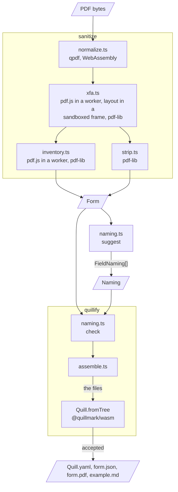

# Architecture

The library has two halves, and the line between them is where a person names the fields. `sanitize` reads a file nobody vouches for and returns plain data: a background PDF this library wrote, the page sizes and the fields. `quillify` takes that data and a naming and writes a quill's files. `suggest` and `check` sit between the two and touch no PDF. Those four functions are the only values `src/index.ts` exports, and every other module is internal.

[`README.md`](../../README.md) has what a call takes and returns. This page has how the code is laid out and why a file passes through it in the order it does. [`prose/DECISIONS.md`](../DECISIONS.md) has the reasons, entry by entry, and [`SECURITY.md`](../../SECURITY.md) the boundary and what is not handled.

## The path of a file

`sanitize.ts` runs four stages in a fixed order. Each takes bytes and gives bytes or data. The first three can decline the file by throwing a `Refused`, which `sanitize` turns into the value it returns. The strip declines nothing. The order is forced: pdf-lib cannot decrypt, so qpdf runs first, and a dynamic form has no fields and no pages of its own until it is converted, so the conversion runs before the two stages that read them.

1. **Normalize** (`normalize.ts`). A file over 8 MiB is refused before anything is loaded. qpdf then rewrites the file with `--decrypt --flatten-rotation --coalesce-contents`: the encryption an empty password opens comes off, a page's own quarter turn is folded into the page, and each page's content streams become one. When qpdf writes nothing, pdf.js is asked to open the original, so that the refusal says why: `password`, `encryption`, `not_pdf`, or `damaged` when pdf.js opens what qpdf could not rewrite.
2. **Convert** (`xfa.ts`, with `xfa-layer.ts`, `display-list.ts` and `xfa-widgets.ts`). A frame is made before the open, for every file that reaches this stage, and pdf.js opens the file with XFA on. A file that is not a dynamic form goes on unchanged. A dynamic one over the page cap is refused as `too_many_pages` here, before a page is laid out. For any other, each page is laid out in the frame, `displayList` reads the text runs, boxes and lines off the DOM, `harvestWidgets` reads the fields, and a new PDF is painted with pdf-lib in the standard 14 fonts and stamped with an AcroForm field where each text field, checkbox, radio button and choice sat. The fields are flat: each is a child of the form's root and carries its whole name, periods included, so a field can be named as the subform beside it. A check box or a radio button is stamped, and its square drawn, on the largest square centered in the control's box, which is where the browser paints it. The file is refused as `unpaintable`, with the page and the construct named, for an image, a background image, a rectangle filled with a gradient or a pattern, an SVG shape other than a line or a rect, a transform or a border style the redraw cannot draw, or a character the standard fonts cannot encode. A field whose control pdf.js writes no HTML for is left out, with the caption printed in it, and nothing is refused for it: a signature field (#43), and by the same path a barcode, a password field, an image field and a field with a `defaultUi` or an empty `<ui/>` (#114).
3. **Inventory** (`inventory.ts`, with `coords.ts`). pdf.js lists each page's widgets. Widgets that share a field name become one entry with several places, except radio buttons and widgets with no name, which stay one entry each. The checkboxes of a name fold only when all of them turn on as one value, which a pass over every page's widgets reads first. When they turn on as more than one, they exclude each other in the file, none of them folds, and each becomes an entry marked as a radio button, with its value as its on-state. Each rect is measured from the top left of pdf.js's view of the page, which is its crop box clipped to its media box. A tooltip a widget inherits from its field is read with pdf-lib. This stage refuses a `portfolio`, a file over the page or field cap, a page that is still `rotated`, and a file with `no_fields`.
4. **Strip** (`strip.ts`). pdf-lib cuts the file down to the background: of the catalog, the page tree, each page and each link only a named set of keys stays, a link stays only when it leads to an `http` or `https` address or to a place in the file, each page's crop box becomes its MediaBox, and every object the catalog no longer reaches is dropped. The trailer counts the objects that are left and carries no `/ID`, so one file gives one background, byte for byte. The catalog's `/OCProperties` stays whole, so a layer keeps its default state (#32). The file is saved with a classic cross-reference table, which the engine requires.

The inventory and the strip both read the output of the conversion, so for a dynamic form what they read is the redraw.

`quillify.ts` runs `check`, then turns each naming entry and its field into what `assemble.ts` writes. The type of a quill field comes from the field's kind, and for a text field from the naming's `text`: `lines` makes it an array of strings and `paragraph` a multiline string. A choice with no option but a blank one is written as a string. The naming has no slot for an option, `required` or a group. `assemble.ts` writes `Quill.yaml` with every name quoted, `example.md` when there is an example to show, `form.json` with one entry for each place of each kept field, and `form.pdf`, which is the background's bytes as they are. A string it writes into `Quill.yaml` or `example.md` is a JSON string literal in which a lone surrogate has become U+FFFD and U+007F to U+009F, U+FFFE and U+FFFF are `\u` escapes, which the engine's YAML reader takes and reads back; a tooltip in `form.json` has its lone surrogates made U+FFFD too. Then `Quill.fromTree` is called on the tree and the handle freed. What the engine refuses comes back as `engine` problems, one for each diagnostic, with the engine's code when it gives one.

## What parses the bytes

Every parser of the bytes a caller hands in runs inside `sanitize`. The engine reads the quill's files, which this library saved, and one of them still carries the file's own bytes: a static form's `form.pdf` holds the page content, fonts and images of the file, which the strip keeps and does not read ([`SECURITY.md`](../../SECURITY.md), #25). The engine decodes them when a consumer opens or renders a document. A dynamic form's `form.pdf` is the redraw.

| Parser | Called from | What it reads | Where it runs |
| --- | --- | --- | --- |
| qpdf | `normalize.ts` | The file | WebAssembly, on the calling thread |
| pdf.js | `pdfjs.ts`, for `normalize.ts`, `xfa.ts` and `inventory.ts` | The file itself only when qpdf wrote nothing. Otherwise what qpdf wrote, in the conversion and again in the inventory, where for a dynamic form it reads the redraw instead | A worker of its own for each open, started from `assets/pdf.worker.js` and ended with the read |
| The browser's layout | pdf.js's `XfaLayer.render`, called from `xfa-layer.ts` | A dynamic form's pages, as the nodes and styles pdf.js's worker makes of them | The DOM of a hidden, sandboxed frame, removed when the conversion ends |
| The browser's image code | pdf.js | An image on a dynamic form's page, which pdf.js hands the frame as a `blob:` URL. The browser loads it, and the page is then refused as `unpaintable` | The frame's document |
| The browser's font code | pdf.js | Each face a dynamic form embeds, which pdf.js makes a `FontFace` from the file's bytes | The host page's realm |
| pdf-lib | `inventory.ts`, `strip.ts` | What qpdf wrote, or for a dynamic form the redraw | The calling thread |
| The engine | `quillify.ts` | `Quill.yaml`, in `Quill.fromTree`. It reads `form.pdf` and `form.json` when the consumer opens or renders a document | WebAssembly, on the calling thread |

`suggest`, `check` and `assemble.ts` parse nothing and import no library. The strings they handle can still be the file's.

## How a call ends

`sanitize` resolves to a `Form` or to a refusal. It rejects in these cases, none of which is the file being declined:

- The argument is not a `Uint8Array` (`TypeError`), checked by its tag, so one made in another window is taken. An `ArrayBuffer`, a `DataView` and every other typed array are not, and the call starts no worker.
- There is no `Worker` or no `document`, as in Node (`ReferenceError`, #34).
- `assets/pdf.worker.js` or `assets/qpdf.wasm` did not load. The error names the file, and the next call tries again.
- The frame's stylesheet did not apply, the host page hid or removed the frame, or a page laid out to nothing.
- pdf.js or pdf-lib threw something no rule maps to a refusal. The known cases are open issues: #77, #80. Any failure of pdf.js's XFA layout is one more (#139): pdf.js catches it, and what arrives is its `UnknownErrorException` saying `Cannot read properties of undefined (reading 'length')`.

It can also not settle: `sanitize` has no deadline (#86), and a frame the host page removes before it has loaded leaves it pending (#99).

`quillify` resolves to a tree or to problems. It rejects when `check` throws, when the engine's binary does not load, which is the engine's own `runtime::init_failed`, and on an error from `Quill.fromTree` that is not the engine's. `suggest` and `check` return at once. `check` throws a `TypeError` that names the slot when the naming is not shaped as its type says, since a naming can be a model's JSON. Neither checks its fields, which are `sanitize`'s to shape.

## Modules

| Module | What it holds |
| --- | --- |
| `index.ts` | The four functions and the public types |
| `api.ts` | `Form`, `Field`, `Place`, `Size`, `Naming`, `FieldNaming`, `Problem` |
| `refusal.ts` | `Refusal`, and the `Refused` error a stage throws |
| `types.ts` | The internal shapes, the three caps, and `Rect`, which is public |
| `sanitize.ts` | The order of the stages, and `InventoryWidget` to `Field` |
| `normalize.ts` | qpdf, and the size cap |
| `pdfjs.ts` | `openPdf`: one worker per open, a close that ends it, and pdf.js's errors as refusals |
| `xfa.ts` | The conversion of a dynamic form: its page cap, paint and stamp |
| `xfa-layer.ts` | `XfaStage`, the frame a page is laid out in |
| `display-list.ts` | What a laid-out page shows, as runs, boxes and lines |
| `xfa-widgets.ts` | The fields of a laid-out page, and `square`, where the browser paints a check box in its box |
| `inventory.ts` | The widgets of a static PDF, the page and field caps |
| `coords.ts` | A PDF rect measured from the top left of its page |
| `strip.ts` | The background |
| `naming.ts` | `suggest` and `check` |
| `quillify.ts` | `quillify`: a field's type and example, and the engine's verdict |
| `assemble.ts` | The quill's files as text and bytes |

Imports run one way. `sanitize.ts` imports the four stages, and no stage imports another. A stage imports `pdfjs.ts`, `refusal.ts`, `types.ts` and its own helpers as it needs them: `xfa.ts` has `xfa-layer.ts`, `display-list.ts` and `xfa-widgets.ts`, `inventory.ts` has `coords.ts`, and `strip.ts` imports pdf-lib alone. One helper imports another: `display-list.ts` takes from `xfa-widgets.ts` the function that says where a check box is painted. pdf.js and qpdf are imported when first used, so importing the entry point loads neither. pdf-lib and the engine's JavaScript are imported with it.

## Shapes

A stage returns internal shapes and refuses in a public one: the `Refusal` it throws is the value `sanitize` returns. What a stage returns meets the public types in two places:

- `field` in `sanitize.ts` turns an `InventoryWidget` (a PDF field type, `Tx`, `Btn`, `Ch` or `Sig`, with its flags) into a `Field` of one of five kinds. Page sizes and places cross as they are.
- `quillify` in `quillify.ts` builds what `assemble.ts` reads: `typed` gives a field its type and options, `shown` its example and `WIDGET` the field type a signature is told by, and the rest is copied in place.

Every `Rect` is `{ x, y, w, h }` from the top left of its page, in the page's own units. A unit is a point unless a page sets `/UserUnit`, which the inventory does not read and the strip keeps (#117). Pages are zero-based in the public types. The frame a rect is measured in is pdf.js's view of the page, its crop box clipped to its media box. The strip makes the crop box as written the background's MediaBox, and the two differ when a crop box reaches past its media box (#28).

## Assets and the build

The package carries three files that are not its own code: the pdf.js worker, `qpdf.wasm` and a slice of pdf.js's viewer stylesheet. `npm run assets` writes the worker and `qpdf.wasm` to `assets/` from `node_modules`, and the stylesheet from `src/xfa-layer.css` as a module, with a declaration file beside it. It stops unless the installed worker has each line it guards at the count of sites the guard is written for, two for the null guard, one for each of the overflow leader's two lines and one for the page set, and ends in its source map line, and `qpdf.wasm` has the recorded hash.

| File | What it is | How the source loads it |
| --- | --- | --- |
| `pdf.worker.js` | The pdf.js worker with a null guard at two sites, an overflow leader that leaves a page's first unsplittable node as it was, and a page set that clears its page areas' counts when it starts another pass | `new URL('../assets/pdf.worker.js', import.meta.url)` in `pdfjs.ts`, handed to `new Worker` |
| `qpdf.wasm` | qpdf, compiled to WebAssembly by `@neslinesli93/qpdf-wasm` | `new URL('../assets/qpdf.wasm', import.meta.url)` in `normalize.ts`, handed to qpdf's loader |
| `xfa-layer.js` | The XFA rules of pdf.js's viewer stylesheet, as a module's text | A static import in `xfa-layer.ts` |

`npm run build` runs `npm run assets` and compiles `src/` to `dist/`, beside `assets/`, so the relative paths hold in the build as they do in the source. The package's one export is `dist/index.js`. [`NOTICE`](../../NOTICE) says where each of the three files comes from and under what license.

## Tests

A test file's name picks its runner: `*.browser.test.ts` runs in headless Chromium, and every other test file in node. Among what the suite holds the library to, by kind of evidence:

- **Goldens.** The inventory of each of the nine published fixtures, compared whole with its golden. A golden is the dump of the code this was carried from, but for the rect of each check box and radio button on the three dynamic forms, which is the square the browser paints ([`DECISIONS.md`](../DECISIONS.md), 10 October).
- **Closure.** For the ten fixtures in the gate, and for 49 published forms in `npm run corpus`, the engine renders the quill and every stamped field is read back with qpdf at the page and rect `form.json` gives.
- **Page identity.** Every pixel of each fixture's pages, the background against the file the strip was given, with annotations not drawn. For a dynamic form that file is the redraw.
- **Rules of the strip.** A test for each thing the background must not keep, most on a PDF built in the test. Of the `strip*` files two strip a fixture, the synthetic sample and SF 1152 for its thumbnails, and `published-forms.browser.test.ts` holds the backgrounds of the six static fixtures to no form, no usage-rights signature, no XFA packet, no XMP, no script and no `/Info`.
- **Layers.** A form built in the test with an optional content group that is off, one on for the screen and off for paper, and the pattern Acrobat Designer writes: the groups and their default state in the background and in the rendered file, and the pixels pdf.js and the engine's own painter paint from them.
- **Isolation.** What the frame may load, what the host page takes from it, and what `sanitize` requests.
- **The package.** What `assets/` holds, what a tarball holds, that the package imports by its own name where there is no DOM, and that `NOTICE` names what is installed.
- **The manifests.** The totals of `corpus/manifest.json` and `corpus/af-epubs.manifest.json`, which the READMEs and the research record quote. No test holds a page's numbers to them.
- **The README.** Its code block, run as printed.
- **The tables.** The module table of this page, held to `src/`, and the table of the fixtures README, held to the manifest, the goldens and the sample's bytes.

[`test/fixtures/README.md`](../../test/fixtures/README.md) has the fixtures, [`corpus/README.md`](../../corpus/README.md) the 59 forms, and [`prose/research/`](../research/README.md) the research records.
