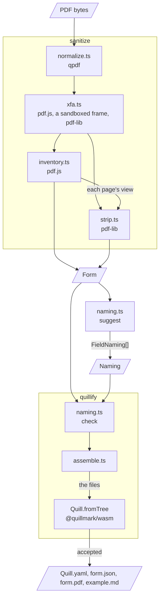

# Architecture

`sanitize` reads a PDF nobody vouches for and returns plain data: a background PDF, the page sizes and the fields. `suggest` proposes a naming of the fields and `check` lists what is wrong with one. `quillify` takes the form and a naming and writes a quill's files. `src/index.ts` exports those four functions and no other value.

[`README.md`](../../README.md) has what a call takes and returns, [`SECURITY.md`](../../SECURITY.md) the boundary, and [`prose/DECISIONS.md`](../DECISIONS.md) why each rule here was chosen and what was measured.

## The path of a file

`sanitize.ts` runs its four stages in that order. A stage declines a file by throwing `Refused`, and `sanitize` returns the refusal. Any other error rejects the call.

One `AbortSignal` fires `MAX_SECONDS` (60) after the call starts. A stage waiting on a worker then ends it, and `sanitize` returns `too_slow`. Work on the calling thread is not interrupted. `sanitize` needs `Worker` and `document`, so it does not run in Node (#34).

## Stages

### Decrypt and normalize

`normalize.ts`. In: the caller's bytes. Out: the file as qpdf rewrote it.

- Every file takes this path, in a qpdf worker of its own.
- qpdf takes off the encryption an empty password opens, folds a page's quarter turn into its content, writes no object stream, and recompresses every stream. Later stages count on all four.
- Size is bounded at `MAX_BYTES` going in, and at `MAX_INFLATED_BYTES` in qpdf and again over what qpdf wrote.

### Convert a dynamic form

`xfa.ts`, with `xfa-layer.ts`, `display-list.ts` and `xfa-widgets.ts`. In: what qpdf wrote. Out: the same bytes, or for a dynamic form a new PDF.

- pdf.js lays each page out in a hidden frame. `displayList` reads what the page shows off the DOM, and `harvestWidgets` its controls. pdf-lib paints the page in the standard 14 fonts and stamps an AcroForm field for each control.
- Nothing is dropped quietly: a construct the redraw cannot draw refuses the file as `unpaintable`.
- No later stage knows a form was dynamic: each reads the redraw.
- pdf.js runs none of the form's scripts (#121).

### Inventory

`inventory.ts`, with `coords.ts`. In: the conversion's bytes. Out: the page sizes, the fields, and each page's `View` (its object and pdf.js's box of it).

- Widgets that share a field name are one field with several places. A radio button, a nameless widget, and a check box whose name has more than one on-state stay one each.
- Every question put to pdf.js is awaited through `within`, or the deadline cannot end it.
- It refuses a portfolio, a file over `MAX_PAGES` or `MAX_WIDGETS`, a rotated page, and a file with no field.

### Strip

`strip.ts`. In: the same bytes and the views. Out: the background (the pages, with no form layer).

- One table, `KINDS`, lists the keys each kind of dictionary keeps. A walk from the catalog gives each object one kind, and deletes every key the kind does not list and every object it does not reach.
- To keep something new, add it to the table, which `test/background.ts` reads too.
- Of a page's annotations, only a link to an `http` or `https` address or to a destination in the file stays.
- Each page's MediaBox is set to its view's box, so a rect and its page share a frame.

### Name and check

`naming.ts`. In: the fields, and for `check` a naming. Out: `FieldNaming[]` from `suggest`, `Problem[]` from `check`.

- `suggest` makes each name snake_case from the tooltip, or else from the field's id.
- `check` throws a `TypeError` for a naming of the wrong shape. Everything else it finds is a `Problem`.

### Assemble

`quillify.ts` and `assemble.ts`. In: a `Form` and a `Naming`. Out: the quill's files, or the problems.

- `quillify` runs `check` and gives each field its quill type. A read-only field is never kept.
- `form.pdf` is the background's bytes as they are. `form.json` has one entry for each place of each kept field.
- Every string in `Quill.yaml` goes through `q`, which writes a JSON string literal.
- `Quill.fromTree` gives the verdict, as `engine` problems.

## Modules

| Module | What it holds |
| --- | --- |
| `index.ts` | The four functions and the public types |
| `api.ts` | `Form`, `Field`, `Place`, `Size`, `Naming`, `FieldNaming`, `Problem` |
| `refusal.ts` | `Refusal`, and the `Refused` error a stage throws |
| `types.ts` | The internal shapes, the five caps, the deadline, and the public `Rect` |
| `sanitize.ts` | The order of the stages, the deadline, and `InventoryWidget` to `Field` |
| `normalize.ts` | qpdf in one worker per file, and the bounds on a file's size |
| `pdfjs.ts` | `openPdf`: one pdf.js worker per open, and pdf.js's errors as refusals |
| `xfa.ts` | The conversion of a dynamic form: paint and stamp |
| `xfa-layer.ts` | `XfaStage`, the frame a page is laid out in |
| `display-list.ts` | What a laid-out page shows: runs, boxes, pictures and lines |
| `xfa-widgets.ts` | The controls of a laid-out page |
| `inventory.ts` | The fields of a static PDF and their tooltips |
| `coords.ts` | A PDF rect measured from the top left of its page |
| `strip.ts` | The background, and the table of what it keeps |
| `naming.ts` | `suggest` and `check` |
| `quillify.ts` | `quillify`: a field's type and example, and the engine's verdict |
| `assemble.ts` | The quill's files as text and bytes |

`sanitize.ts` imports the four stages, and no stage imports another.

## Shapes

The internal shapes are in `types.ts`. They cross to the public types in `field` (`sanitize.ts`) and in `quillify`.

Every `Rect` is `{ x, y, w, h }` from the top left of its page, in the page's own units: points, unless a page sets `/UserUnit`, which the inventory does not read and the strip keeps (#117). Pages are zero-based.

## Assets

`npm run assets` writes `assets/`: the pdf.js worker, the qpdf worker, `qpdf.wasm`, four faces of Liberation Sans, and the frame's stylesheet. [`NOTICE`](../../NOTICE) has their sources.

**How the package finds them.** `normalize.ts` and `pdfjs.ts` name each file but the stylesheet as `new URL('../assets/<file>', import.meta.url)`, which a bundler follows. The build goes to `dist/`, beside `assets/`, so the path holds there as in `src/`.

**Why a dynamic form has a frame of its own.** A frame's document takes no CSS rule from the host page and gives it none. The frame is sandboxed, runs no script, and loads only an image from `blob:` or `data:`.

**The pdf.js worker's guards.** The shipped worker is pdfjs-dist's with the lines in `GUARDS` of `scripts/assets.js` replaced. They get pdf.js through layouts it otherwise fails or cuts short, give a field a control and a box where pdf.js writes none, keep a bound list's template items, mark an embedded page number or count, and rethrow a layout exception as the `layout` refusal.

The script stops when a guarded line is not at its expected count of sites.

## Tests

`*.browser.test.ts` runs in headless Chromium and every other test file in node. A module's tests sit beside it in `src/`. Helpers and the package's tests are in `test/`.

| Kind | What it holds | Where |
| --- | --- | --- |
| Goldens | Each published fixture's inventory, whole | `test/goldens/` |
| Closure | The engine renders the quill, and qpdf reads each field back | `test/closure.ts` |
| Page identity | The background paints as the file the strip was given | `src/page-identity.browser.test.ts` |
| Redraw | A dynamic form's layout against its redraw, text left out | `src/xfa-redraw.browser.test.ts` |
| Background graph | qpdf's JSON of a background, walked against `KINDS` | `test/background.ts` |
| Strip rules | One test for each thing a background must not keep | `src/strip*.test.ts` |
| Isolation | What the frame loads and what `sanitize` requests | `src/xfa-isolation.browser.test.ts` |
| Corpus | 59 published forms, outside the gate | [`corpus/`](../../corpus/README.md) |

[`test/fixtures/README.md`](../../test/fixtures/README.md) has the fixtures.
